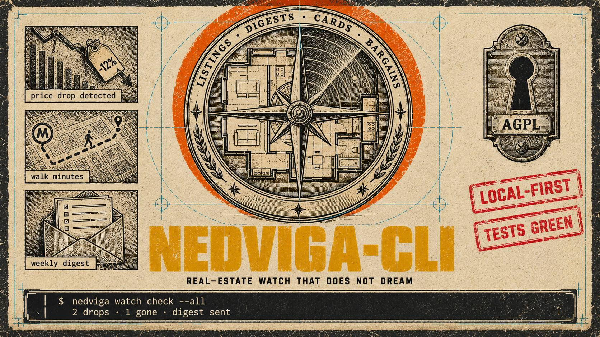

# nedviga-cli — English summary

   


<p align="center"></p>
[ Русский](README.md) · **English**

CLI and Python SDK for residential real-estate selection and analysis in Moscow: search,
decision card, comparison, negotiation, new-build/developer checks, infrastructure, change
monitoring, client report. Agent-ready: MCP server, JSON envelopes, roles, audit.

## Install

```bash
pip install nedviga-cli
nedviga-cli wizard doctor
```

From the repo: `pip install git+https://github.com/lnfnt/nedviga-cli.git`.

From PyPI: `pip install nedviga-cli`. Dev checkout: `pip install -e ".[cli,dev]"` (Python >= 3.11). One-time browser
runtime for live adapters: `XDG_CACHE_HOME="$HOME/.cache/nedviga-py" python3 -m camoufox fetch`.

## Capabilities

- **Sources:** CIAN, Avito, Domclick (browser adapters only via your own egress
  `NEDVIGA_EGRESS_PROXY`), Moscow open data (building dossiers, utility charges, new-build
  registry, developers by INN with banks and court cases, noise monitoring). EGRN is not
  used; an owner-extract intake/verification module replaces it.
- **Decision analytics:** object family card, comparison matrix, per-complex negotiation
  medians (`insufficient_sample` on thin data), bait flags, risk scoring, 11 legal triage
  markers.
- **Lifecycle:** status pipeline, price/withdrawal/relist watch, digests, profile-based
  auto-matching, alternative chains, match scoring.
- **Artifacts:** PDF/HTML catalog, PPTX decks, viewing plan, call sheets, lawyer handover
  checklists.
- **Environment:** walking-distance POIs, traffic load and hourly web forecast (marked as a
  non-guaranteed web estimate), dated noise measurements.
- **Security:** fail-closed network guard, `<external_untrusted_data>` spotlighting, roles
  and per-record audit, PII minimization (contacts only on an explicit flagged purpose),
  idempotent purge.

## Output contract

One JSON envelope on stdout, logs on stderr; exit codes 0 ok, 1 environment, 2 source
degradation, 3 parser/source error, 4 CLI usage.

## Limits

- Moscow-only sources. No price prediction. Traffic forecast is a marked web estimate.
  PII contacts extraction stays behind an explicit flag.

## License

AGPL-3.0-only; network services built on it must offer the corresponding source (§13,
`nedviga-cli source`). Verify: `sha256sum -c SHA256SUMS`, `gpg --verify *.asc`.

Author and copyright holder: [lnfnt](mailto:lnfnt@proton.me).
